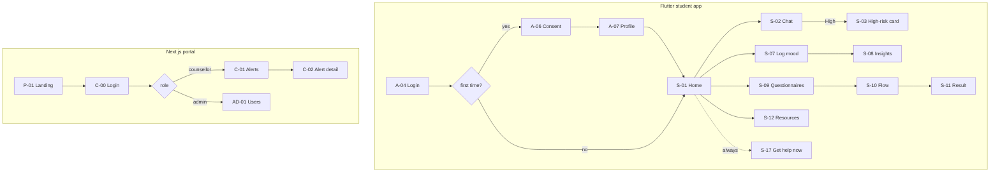

# Screen Inventory

Two frontends:

- **Flutter student app**: one codebase, built for **Android** and **web**. Columns: **A** = Android, **W** = Flutter web.
- **Next.js portal**: public website, counsellor portal and admin.

Priority: **P1** = must ship · **P2** = should ship · **P3** = nice to have.

A floating **"Get help now"** button (→ S-17) is on every student screen.

---

## 1. Next.js — public website (no login)

| # | Screen | Pri | Contents |
| --- | --- | --- | --- |
| P-01 | Landing page | P1 | Hero, how it works (3 steps), features, privacy promise, "not a clinical tool" notice, download APK + open web app |
| P-02 | How it works / About | P2 | Pipeline explained simply, team, college |
| P-03 | Privacy & terms | P1 | What is stored, what is not, DP explained in plain words, third-party AI processing |
| P-04 | Crisis helplines (public) | P1 | Helpline list, reachable **without login** |

## 2. Flutter — auth and onboarding (student)

| # | Screen | A | W | Pri | Contents |
| --- | --- | --- | --- | --- | --- |
| A-01 | Splash | ✓ | ✓ | P1 | Logo, session check |
| A-02 | Onboarding carousel | ✓ | ✓ | P2 | 3 slides: talk, track, get help |
| A-03 | Sign up | ✓ | ✓ | P1 | Email, password, Google; college email domain check |
| A-04 | Login | ✓ | ✓ | P1 | Supabase login |
| A-05 | Forgot / reset password | ✓ | ✓ | P1 | Supabase reset flow |
| A-06 | **Consent** | ✓ | ✓ | P1 | Terms (required), AI processing (required for chat), camera, microphone, counsellor contact (each optional) |
| A-07 | Profile setup | ✓ | ✓ | P2 | Nickname, department, year (optional), reminder time |
| A-08 | App lock | ✓ | | P3 | Fingerprint / PIN (`local_auth`) |

## 3. Flutter — student app (core)

| # | Screen | A | W | Pri | Contents |
| --- | --- | --- | --- | --- | --- |
| S-01 | **Home** | ✓ | ✓ | P1 | Greeting, quick mood check-in (5 emojis), "Talk to companion" CTA, mood streak, tip of the day, pending questionnaire nudge |
| S-02 | **AI Chat** | ✓ | ✓ | P1 | Streaming replies, mic button, optional camera check-in, emotion chip, resource cards, "sources" expander, disclaimer bar |
| S-03 | Chat — high-risk state | ✓ | ✓ | P1 | Calm full-width card: "You're not alone", helplines with tap-to-call, "a counsellor has been notified", breathing exercise link |
| S-04 | Conversation history | ✓ | ✓ | P2 | List, rename, delete |
| S-05 | Voice check-in | ✓ | ✓ | P2 | Record up to 15 s, waveform, "audio is not saved" |
| S-06 | Face check-in | ✓ | ✓ | P3 | Camera preview, single capture, "image is not saved" |
| S-07 | **Mood & sleep log** | ✓ | ✓ | P1 | Mood 1–5, sleep hours, energy, tags (exam, family…), note |
| S-08 | **Journal history & insights** | ✓ | ✓ | P1 | 7/30-day charts for mood and sleep (fl_chart), calendar heatmap, patterns |
| S-09 | Questionnaire list | ✓ | ✓ | P1 | PHQ-9, GAD-7, DASS-21, last taken date |
| S-10 | **Questionnaire flow** | ✓ | ✓ | P1 | One question per step, progress bar, back button |
| S-11 | Questionnaire result | ✓ | ✓ | P1 | Score band (framed as "screening", not a diagnosis), what it means, next steps, history graph |
| S-12 | Resource library | ✓ | ✓ | P1 | Tabs: coping, study, campus, helplines; search |
| S-13 | Resource detail | ✓ | ✓ | P2 | Article, steps, related resources |
| S-14 | Breathing / grounding exercise | ✓ | ✓ | P2 | Animated box breathing, 5-4-3-2-1 grounding |
| S-15 | Notifications | ✓ | | P3 | Reminders, counsellor follow-up (FCM) |
| S-16 | Settings & privacy | ✓ | ✓ | P1 | Consent toggles, reminders, export data, delete account, theme |
| S-17 | **Get help now (SOS)** | ✓ | ✓ | P1 | "Contact counsellor" button (creates an alert), helplines, campus contacts |
| S-18 | Profile | ✓ | ✓ | P2 | Nickname, department, year |

## 4. Next.js — counsellor portal

| # | Screen | Pri | Contents |
| --- | --- | --- | --- |
| C-00 | Counsellor login | P1 | Supabase login; rejects non-counsellor roles |
| C-01 | **Alerts dashboard** | P1 | Live list (Supabase Realtime) with a sound/toast on new alert; filters: open / acknowledged / closed; time since raised |
| C-02 | **Alert detail** | P1 | Pseudonym, time, risk level, trigger reason, emotion summary, recent mood trend; contact details only if the student consented; Acknowledge, Add note, Close; every view is audit-logged |
| C-03 | Insights | P2 | Anonymised, DP: mood trend across campus, stress peaks around exams, questionnaire band distribution; cohorts < 10 hidden |
| C-04 | Knowledge base | P1 | Upload PDF/URL → ingestion status → **Verify** toggle; list of chunks |
| C-05 | Resources & helplines | P1 | CRUD, "last verified" date |
| C-06 | Counsellor settings | P3 | Notification channels, availability |

## 5. Next.js — admin

| # | Screen | Pri | Contents |
| --- | --- | --- | --- |
| AD-01 | Users & roles | P2 | Invite counsellors, change roles, deactivate |
| AD-02 | Audit log | P2 | Who viewed which alert, when |
| AD-03 | System health | P3 | API, worker and model versions, LLM spend this month |

**Totals:** Flutter 26 screens (built once, shipped to Android + web) · Next.js 14 screens (4 public, 7 counsellor, 3 admin) = **40 screens**. **P1 only: 25 screens**, which is the realistic 4-week target.

---

## 6. Navigation



Flutter bottom navigation bar (Android and narrow web): **Home · Chat · Journal · Resources · Me**

Flutter on wide web screens: the same 5 items in a `NavigationRail` on the left, with a right panel showing today's mood and a help card.

---

## 7. Key wireframes

### S-01 Home (Flutter, Android)

```
┌──────────────────────────────┐
│ Good evening, Aru  🔔        │
│ How are you feeling today?   │
│ 😞  🙁  😐  🙂  😄           │
├──────────────────────────────┤
│ 💬 Talk to your companion  › │
├──────────────────────────────┤
│ 🔥 5-day check-in streak     │
│ ▁▃▅▄▆▇▅  mood this week      │
├──────────────────────────────┤
│ 💡 Tip: 4-7-8 breathing      │
│ 📝 GAD-7 due (2 min)       › │
├──────────────────────────────┤
│        [ 🆘 Get help now ]   │
│ Home  Chat  Journal  Res  Me │
└──────────────────────────────┘
```

### S-02 AI Chat (Flutter)

```
┌──────────────────────────────┐
│ ‹  Companion       ⓘ  🆘     │
│ Not a substitute for         │
│ professional help.           │
├──────────────────────────────┤
│        I can't focus, exams  │
│        are next week and I   │
│        feel useless.  [anx]  │
│ ┌──────────────────────────┐ │
│ │ That sounds really heavy │ │
│ │ ... try a 25-min block   │ │
│ │ ▸ Sources (2)            │ │
│ └──────────────────────────┘ │
│ ┌ 📘 Exam stress toolkit  ›┐ │
│ └──────────────────────────┘ │
├──────────────────────────────┤
│ [📷] [ Type a message… ] [🎤]│
└──────────────────────────────┘
```

### C-01 Counsellor alerts (Next.js)

```
┌────────────┬───────────────────────────────────────────────┐
│ Alerts  ●3 │ Open (3)  Acknowledged (5)  Closed            │
│ Insights   ├───────────────────────────────────────────────┤
│ Knowledge  │ ● HIGH  Student #A7F2  crisis phrase   2m ago │
│ Resources  │ ● HIGH  Student #19C0  PHQ-9 item 9   18m ago │
│ Settings   │ ● HIGH  Student #B3D1  manual SOS     41m ago │
│            ├───────────────────────────────────────────────┤
│            │ Detail: #A7F2 · CSE Y3 · mood ▼ 4 days        │
│            │ Contact: consented → +91 ••••• 4410           │
│            │ [Acknowledge]  [Add note]  [Close]            │
└────────────┴───────────────────────────────────────────────┘
```

---

## 8. Design direction

- Calm, low-arousal palette (soft teal or sage on warm off-white; a true dark mode). Red is used **only** for SOS.
- Large touch targets and short copy; no gamification pressure (streaks are gentle and never shame a missed day).
- Accessibility: WCAG AA contrast, screen-reader labels (`Semantics` in Flutter), reduced-motion support for the breathing animation.
- The same colour and type tokens are defined in Flutter `ThemeData` and the Next.js Tailwind config so both look like one product.
