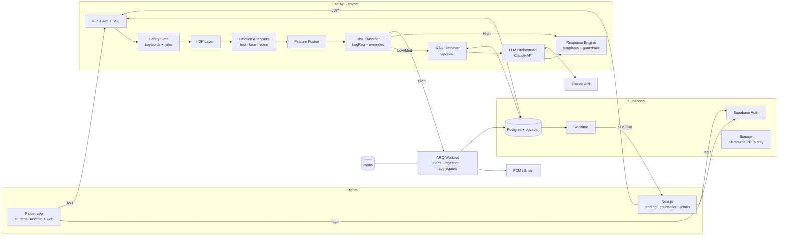
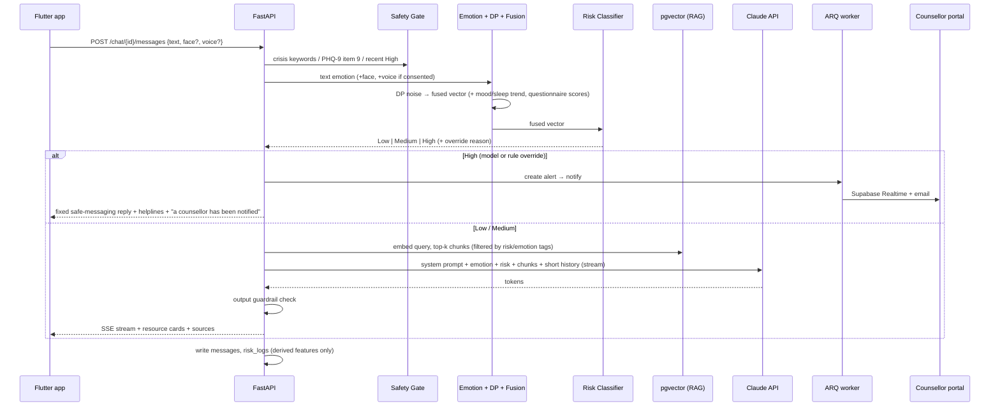
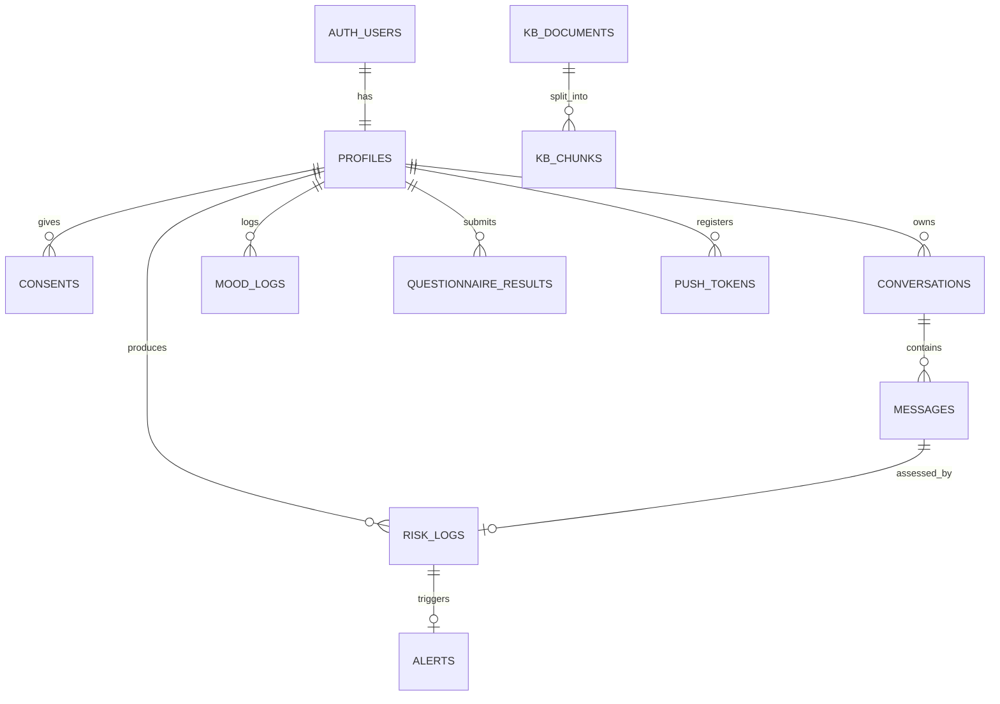

# System Design — AI Student Mental Health Companion

> Version 1.1 · 15 Nov 2026 · Flutter + Next.js + FastAPI + Supabase + RAG/LLM.
> A supportive screening tool, **not** a diagnostic or clinical tool.

---

## 1. Stack decision

| Layer | Choice | Notes |
| --- | --- | --- |
| Student app (Android + web) | **Flutter 3** (Riverpod, go_router, supabase_flutter, dio, fl_chart) | **One codebase** builds the Android APK and the student web app |
| Public website + counsellor/admin portal | **Next.js 15 (App Router) + TypeScript + Tailwind + shadcn/ui** | Landing page (SEO), counsellor alert dashboard, knowledge-base manager, admin |
| Backend API | **FastAPI (Python 3.11)**, Pydantic v2, SQLAlchemy 2 (async) + asyncpg | See §1.1 for why FastAPI and not Django |
| Background jobs | **ARQ (async Redis queue)** | Alert notifications, RAG document ingestion, nightly aggregates |
| Database | **Supabase Postgres + pgvector** | Schema, RLS and SQL functions are managed by Supabase CLI migrations (the single source of truth) |
| Auth | **Supabase Auth** (email/password, Google) | FastAPI verifies the Supabase JWT (JWKS) as a dependency |
| Realtime SOS | **Supabase Realtime** on the `alerts` table | The counsellor dashboard updates live |
| Push notifications | **Firebase Cloud Messaging** | Reminders and follow-ups to the Android app |
| LLM | **Claude API, `claude-opus-5-5`** through the official `anthropic` Python SDK (async client) | Hidden behind an `LLMProvider` interface; a local model (Ollama) can replace it |
| Embeddings | **`BAAI/bge-small-en-v1.5`** (384-dim, local sentence-transformers) | Free; RAG text is never sent out for embedding |
| Emotion / risk ML | DistilBERT (GoEmotions), MediaPipe + FER-2013 CNN, librosa MFCC + CNN (RAVDESS), Logistic Regression | Unchanged from the brief; this is the academic core |
| Privacy | Opacus DP-SGD + calibrated Laplace noise on fused features | Unchanged from the brief |
| API clients | **Generated from FastAPI's OpenAPI schema**: `openapi-generator` (dart-dio) for Flutter, `openapi-typescript` for Next.js | Both frontends stay in sync with the backend automatically |
| Hosting (demo) | Supabase Cloud · Render/Railway (FastAPI + ARQ + Redis) · Vercel (Next.js) · Firebase Hosting or Vercel (Flutter web) · APK from `flutter build apk` | |

### 1.1 FastAPI or Django: FastAPI

The deciding factor is that **Supabase and Flutter take over the things Django would have given you**:

| Need | Who covers it now | Effect on the choice |
| --- | --- | --- |
| User accounts, password reset, OAuth | Supabase Auth | Django's auth system is not needed |
| Admin CRUD for tables | Supabase Studio + the Next.js portal | Django Admin loses most of its value |
| Schema and migrations | Supabase CLI SQL migrations (needed anyway for RLS, pgvector, `auth.users` FK) | The Django ORM would fight a schema it does not own |
| Two clients in different languages (Dart + TypeScript) | **FastAPI auto-generates OpenAPI** → typed clients for both | Strong FastAPI win; DRF needs extra packages for the same thing |
| Streaming LLM replies (SSE) | Native async in FastAPI | FastAPI win |
| Serving PyTorch/sklearn models | FastAPI is the common choice for ML serving | FastAPI win |
| Request/response validation | Pydantic models, shared with the ML code | FastAPI win |

Django would still be the better choice for a project that owns its own auth and needs a built-in admin. With Supabase in the stack, FastAPI is lighter, faster to build with, and fits the ML and LLM work. It is also what the original brief planned, so the team has no stack change.

### 1.2 Why Flutter for students and Next.js for the portal

- **Flutter** gives one student app for Android and web, so the 18 student screens are built once, not twice.
- **Next.js** is better for the public landing page (SEO, fast first load) and for desk-based dashboards (tables, filters, charts) used by counsellors on laptops.
- Counsellors and admins never use the Flutter app; students never use the Next.js portal (except the public landing page).

---

## 2. High-level architecture



### 2.1 Responsibilities

| Component | Does | Does not |
| --- | --- | --- |
| Flutter app | Student UI, Supabase login, calls FastAPI with the JWT, renders streamed replies, camera/mic capture | Talk to the LLM or write risk data directly |
| Next.js portal | Landing page; counsellor alerts, insights, knowledge base; admin | Any student features |
| Supabase Auth | Identity, sessions, password reset, OAuth | Roles (stored in `profiles.role`) |
| FastAPI | All business logic, AI pipeline, authorisation | Store raw audio or video |
| Supabase Realtime | Pushes new `alerts` rows to counsellors (RLS-filtered) | Anything for students |
| ARQ workers | Slow or async work: notifications, KB ingestion, nightly insights | Anything on the chat reply path |

---

## 3. The AI pipeline (one chat turn)



### 3.1 Key design rules

1. **The LLM never decides risk.** Risk comes from the trained classifier plus hard rules. The LLM only writes supportive replies. This keeps the academic metrics (recall on High, confusion matrix) meaningful and the system testable.
2. **High-risk replies are deterministic templates**, not LLM text. They are reviewed once and unit-tested, with no chance of a harmful generation at the worst moment.
3. **Rule overrides force High:** self-harm keywords or phrases, PHQ-9 item 9 > 0, or 2+ Medium in 24 h with a falling mood trend (tunable).
4. **Text-only works.** Fusion fills absent modalities with a "missing" mask, not zeros that look like neutral.
5. **Raw media is never stored.** Audio and frames are processed in memory and discarded; only labels and probabilities are saved.
6. **Models load once** at FastAPI startup (lifespan handler); CPU-heavy inference runs in a thread pool so the event loop is not blocked.

### 3.2 RAG design

**Knowledge base (D4):** curated, verified content only.

| Source type | Examples | Tags |
| --- | --- | --- |
| Coping techniques | Box breathing, 5-4-3-2-1 grounding, sleep hygiene, exam-stress tips (WHO, NHS, NIMH public pages) | `emotion:anxiety`, `topic:sleep` |
| College resources | Counselling cell hours, how to book, campus contacts | `type:campus` |
| Helplines | Tele-MANAS 14416, KIRAN, college counsellor numbers (**verify before the demo**) | `type:helpline` |
| Study support | Time management, burnout, procrastination | `topic:academic` |
| Safe-messaging guidelines | Used inside the system prompt, not retrieved | n/a |

**Ingestion (ARQ worker):** a counsellor uploads a PDF or URL in the Next.js portal → text extraction → chunks of about 500 tokens with 80 overlap → bge-small embeddings → `kb_chunks` with an HNSW index. A document is **only retrievable after a counsellor or admin sets `verified = true`**.

**Retrieval:** hybrid search (pgvector cosine + Postgres full-text, merged with reciprocal-rank fusion) → top 5, filtered by tags matching the detected emotion. The SQL lives in a Postgres function `match_kb_chunks(query_embedding, tags, k)`.

**Prompt assembly** (stable parts first so prompt caching works):

```
[system]  role, tone, safe-messaging rules, "not a therapist, never diagnose",
          "always offer human help", answer only from context for factual claims   ← cached
[system]  retrieved chunks with ids                                                 ← per turn
[messages] last 6 turns + rolling summary of older turns
[user]    current message + (emotion=sad 0.72, risk=medium) as metadata
```

**Output guardrails:** a regex and keyword scan for diagnosis language ("you have depression"), method details and medication dosing. On a hit, replace the reply with a safe fallback and log it. Handle `stop_reason == "refusal"` from the API with the same fallback; server-side refusal fallbacks (`fallbacks: "default"`) are on.

### 3.3 LLM choice

| | Default | Notes |
| --- | --- | --- |
| Model | `claude-opus-5-5` ($4 / $20 per M tokens in/out) | Best empathy and instruction-following. You can switch to `claude-sonnet-5-5` or `claude-haiku-5-5` in `.env` if the budget is tight; that is a one-line change behind `LLMProvider` |
| Effort | `low` | Chat does not need deep reasoning; this keeps latency down |
| Streaming | Yes (SSE to the client) | |
| Prompt caching | On for the system prompt | Cuts cost on every turn |
| Privacy | Only pseudonymous text is sent: names, emails, phone numbers and roll numbers are scrubbed first. The consent screen states that messages are processed by a third-party AI provider | `LLM_PROVIDER=ollama` keeps all data on-premise (lower reply quality) |

### 3.4 Differential privacy placement

- **Training:** the risk classifier and DistilBERT head are trained with Opacus DP-SGD. Report accuracy against ε ∈ {0.5, 1, 2, 5, 10}.
- **Inference:** Laplace noise on the fused feature vector before it is stored in `risk_logs`.
- **Aggregates:** counsellor insights use DP counts and hide any cohort smaller than 10 students (k-anonymity).

---

## 4. Data model (Supabase Postgres)



| Table | Key columns |
| --- | --- |
| `profiles` | `id uuid PK = auth.users.id`, `role (student/counsellor/admin)`, `display_name`, `department`, `year`, `pseudonym`, `created_at` |
| `consents` | `user_id`, `kind (terms/ai_processing/camera/microphone/counsellor_contact)`, `granted`, `policy_version`, `at` |
| `conversations` | `id`, `user_id`, `title`, `summary`, `created_at`, `deleted_at` |
| `messages` | `id`, `conversation_id`, `role (user/assistant/system)`, `content` (encrypted with pgcrypto), `emotion_label`, `risk_level`, `sources jsonb`, `created_at` |
| `mood_logs` | `user_id`, `mood_score 1-5`, `sleep_hours`, `energy`, `tags[]`, `note`, `created_at` |
| `questionnaire_results` | `user_id`, `instrument (PHQ9/GAD7/DASS21)`, `answers jsonb`, `score jsonb`, `severity`, `item9_flag`, `created_at` |
| `risk_logs` | `user_id`, `message_id?`, `text_emotion jsonb`, `face_emotion jsonb?`, `voice_emotion jsonb?`, `fused_vector jsonb (DP)`, `risk_level`, `override_reason?`, `model_version`, `created_at` |
| `alerts` | `id`, `user_id`, `risk_log_id`, `status (open/acknowledged/closed)`, `assigned_to?`, `acknowledged_by?`, `acknowledged_at?`, `notes`, `created_at` |
| `resources` | `title`, `type (helpline/tip/study/exercise/campus)`, `url_or_phone`, `body_md`, `tags[]`, `verified_at` |
| `kb_documents` | `title`, `source_url / storage_path`, `type`, `verified`, `uploaded_by`, `created_at` |
| `kb_chunks` | `document_id`, `content`, `embedding vector(384)` + HNSW index, `tags[]`, `tsv tsvector` |
| `push_tokens` | `user_id`, `fcm_token`, `platform` |
| `audit_logs` | `actor_id`, `action`, `target`, `at` — every counsellor view of an alert is logged |

**Migrations:** SQL files in `supabase/migrations/` (Supabase CLI) create the tables, RLS policies, pgvector index and `match_kb_chunks()`. FastAPI's SQLAlchemy models mirror these tables and do not create them.

**Row-level security** is enabled on every table as defence in depth: students see only their own rows, counsellors see `alerts` (needed for Realtime) and nothing else directly. FastAPI connects with a server-only role through the Supabase pooler in transaction mode (asyncpg with `statement_cache_size=0`).

---

## 5. API contract (`/api/v1`)

All routes need `Authorization: Bearer <supabase JWT>`. Sign-up, login and password reset are handled by Supabase Auth on the client. Interactive docs are at `/docs` (Swagger), and the OpenAPI schema at `/openapi.json` drives client generation.

| Area | Method and path | Role |
| --- | --- | --- |
| Me | `GET/PATCH /me`, `POST /me/consents`, `GET /me/export`, `DELETE /me` | student |
| Chat | `GET/POST /conversations`, `GET /conversations/{id}/messages`, `POST /conversations/{id}/messages` → **SSE stream**, `DELETE /conversations/{id}` | student |
| Multimodal | `POST /analyze/face` (frame), `POST /analyze/voice` (clip ≤ 15 s) → label only | student |
| Journal | `POST/GET /journal`, `GET /journal/insights?range=30d` | student |
| Questionnaires | `GET /questionnaires`, `POST /questionnaires/{instrument}` | student |
| Resources | `GET /resources?type=&tag=&q=`, `GET /resources/{id}` | any |
| SOS | `POST /sos` (manual "I need help now" button → always creates an alert) | student |
| Push | `POST /push-tokens` | student |
| Alerts | `GET /alerts?status=`, `GET /alerts/{id}`, `PATCH /alerts/{id}` | counsellor |
| Insights | `GET /insights/overview`, `GET /insights/trends` (anonymised, DP) | counsellor |
| Knowledge base | `GET/POST /kb/documents`, `PATCH /kb/documents/{id}` (verify), `DELETE` | counsellor/admin |
| Admin | `GET/PATCH /admin/users`, `GET /admin/audit`, `GET /admin/health` | admin |
| Health | `GET /health` | public |

---

## 6. Repository structure

```
mh-companion/
├── mobile/                     # Flutter: student app (Android + web)
│   ├── lib/
│   │   ├── core/               # router, theme, supabase init, env
│   │   ├── api/                # generated dart-dio client (do not edit)
│   │   ├── features/           # auth, consent, home, chat, journal, questionnaires,
│   │   │                       # resources, sos, settings — each: data/ state/ ui/
│   │   └── shared/             # widgets, disclaimer bar, help button
│   └── test/
├── portal/                     # Next.js: (marketing) (counsellor) (admin) route groups
├── backend/                    # FastAPI
│   ├── app/
│   │   ├── main.py             # app factory, lifespan (load models), routers
│   │   ├── core/               # config, Supabase JWT verification, role dependencies
│   │   ├── db/                 # async session, SQLAlchemy models (mirror Supabase schema)
│   │   ├── routers/            # me, chat, analyze, journal, questionnaires, resources,
│   │   │                       # sos, alerts, insights, kb, admin
│   │   ├── schemas/            # Pydantic models
│   │   ├── services/           # chat orchestration, alerts, notifications
│   │   └── workers/            # ARQ tasks: notify, ingest_document, nightly_insights
│   ├── ai/                     # framework-free, unit-testable
│   │   ├── safety.py           # keyword rules, overrides, output guardrails
│   │   ├── scoring.py          # PHQ-9, GAD-7, DASS-21
│   │   ├── emotion/            # text.py face.py voice.py
│   │   ├── privacy.py          # DP noise
│   │   ├── fusion.py
│   │   ├── risk.py
│   │   ├── rag.py              # embed + retrieve
│   │   ├── llm.py              # LLMProvider (Claude / Ollama)
│   │   └── responses.py        # templates for High risk
│   └── tests/
├── ml/                         # training code + Colab notebooks + epsilon experiment
├── models/                     # exported weights (git-ignored)
├── supabase/                   # config + SQL migrations: tables, RLS, pgvector, functions, seed
├── docs/
└── docker-compose.yml          # api, worker, redis (Supabase local via `supabase start`)
```

---

## 7. Security, privacy and ethics checklist

- Consent screen before first use; separate toggles for AI processing, camera, mic and counsellor contact; all revocable in Settings.
- HTTPS only; JWT verified against the Supabase JWKS; roles checked by FastAPI dependencies; RLS in Postgres.
- Raw audio and video are never persisted; message content is encrypted at rest; students can export or delete their data.
- Counsellors see the **minimum** for an alert: pseudonym, time, risk level, triggering signal (e.g. "PHQ-9 item 9" or "crisis phrase"), and the student's contact details **only if** the student consented. No full chat transcript unless the student chooses to share it.
- Every screen shows the notice: "This app does not replace professional help." The helpline button is reachable from every student screen in one tap.
- Rate limiting on chat (`slowapi`) for abuse and cost control; a monthly LLM budget cap with a fallback to template replies.
- Only public or synthetic data during development. Helpline numbers are verified before the demo.

---

## 8. Build plan (4 weeks, 3 people)

| Week | Person A — Flutter + Next.js | Person B — FastAPI + Supabase | Person C — ML/AI |
| --- | --- | --- | --- |
| 1 (16–22 Nov) | Flutter skeleton: login, consent, home, mood log | Supabase schema + RLS, FastAPI auth, journal + me APIs, OpenAPI client generation | Text emotion fine-tune (Colab), questionnaire scoring + tests |
| 2 (23–29 Nov) | Flutter chat with SSE, questionnaires, journal insights | Chat API, RAG ingestion + retrieval, Claude integration, guardrails | Face + voice models (pretrained fallback), fusion |
| 3 (30 Nov–6 Dec) | Next.js portal: alerts (Realtime), alert detail, KB manager; Flutter resources + SOS | Risk pipeline wiring, alerts + ARQ + FCM, insights | Risk classifier, DP layer, ε experiment + plots |
| 4 (7–11 Dec) | Landing page, polish, Flutter web build, usability test with 5–10 peers | Integration + API tests, deployment | Evaluation metrics, report and slides |

**If time slips, cut in this order:** face check-in → voice check-in → insights page → landing page (use a simple page) → hybrid search (pure vector). **Never cut:** consent, safety gate, SOS, disclaimers.
